## Hi, I'm Alief

Informatics Engineering student at Universitas Hasanuddin building full-stack web and mobile applications. I enjoy turning ideas into reliable, well-structured software across the web and mobile stack.

[Website](https://aliefmohi.web.id) · [LinkedIn](https://www.linkedin.com/in/mohamad-alief-nauval-mohi/) · [Instagram](https://www.instagram.com/aliefmohi)

---

### Tech Stack

<picture>
  <source media="(prefers-color-scheme: dark)" srcset="https://skillicons.dev/icons?i=ts,nextjs,react,tailwind,flutter,dart,kotlin,supabase,firebase,postgres&theme=dark" />
  <source media="(prefers-color-scheme: light)" srcset="https://skillicons.dev/icons?i=ts,nextjs,react,tailwind,flutter,dart,kotlin,supabase,firebase,postgres&theme=light" />
  
</picture>

---

<picture>
  <source media="(prefers-color-scheme: dark)" srcset="https://raw.githubusercontent.com/aetheramizu/aetheramizu/output/pacman-contribution-graph-dark.svg">
  <source media="(prefers-color-scheme: light)" srcset="https://raw.githubusercontent.com/aetheramizu/aetheramizu/output/pacman-contribution-graph.svg">
  
</picture>

  

